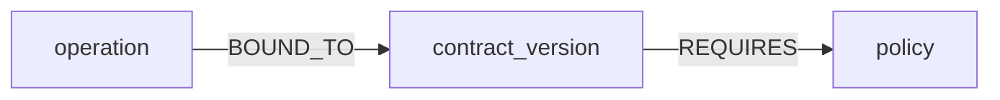

# EffectBound

EffectBound is one checkout that timed out after the effect committed.

FalkorDB's REQUIRES edge returns reconcile, complete, or stop.

The counter scores the store. Health ok is not recovery.

On 17 Oct 2026 the local screen showed REQUIRES reconcile and counter match, then REQUIRES stop and counter match, then halt when the container stopped.

There is no public deployment and no demo video. The run is local.

The graph `changeguard_checkout` holds these nodes: operation, observed_effect, dependency, contract_version, policy, approval, attempt, outcome.



The other relationships are operation `HAS_EFFECT` observed_effect, operation `DEPENDS_ON` dependency, attempt `AUTHORIZED_BY` approval, attempt `OF` operation, and attempt `YIELDED` outcome.

The decision is this read.

```
MATCH (:operation {id: $operation_id})-[:BOUND_TO]->(:contract_version)-[req:REQUIRES]->(:policy)
RETURN req.policy_action
```

The pinned image is `falkordb/falkordb@sha256:107455e862a824e45e8e9f5a7fbfdf5e00a08b14e13eae2577c72fd9e3f59ba6`. The container is `changeguard-falkordb`. The data directory is `/var/lib/falkordb/data`. The Python client is FalkorDB 1.8.0.

From this directory:

The compose project name is `changeguard`. A second copy uses that name so it attaches to the same container and the volume `changeguard_changeguard-falkor`.

```
docker compose -p changeguard up -d
```

```
docker inspect changeguard-falkordb --format "{{.Image}}"
```

If `.venv` is missing, create it and install this package with the venv Python. On Windows the interpreter is `.venv\Scripts\python.exe`.

```
python -m venv .venv
.venv\Scripts\python.exe -m pip install -e .
```

```
.venv\Scripts\python.exe -c "from effectbound.pins import IMAGE_DIGEST; print(IMAGE_DIGEST)"
```

```
.venv\Scripts\python.exe -m effectbound.serve
```

The screen URL is `http://127.0.0.1:8767/screen?operation_id=screen-op`.

`effectbound.serve` plants that one checkout.

## Limits

Phase 8 lost-ack: graph reconcile, B6 reconcile, counter match, one row, tie.

Phase 8 contract: graph stop, B6 stop, counter match, one row, tie.

Load: nodes_5000 5000, nodes_50000 50000, 50 sessions, p95_ms 3.502600000501843, other-tenant recall hidden, unfiltered_tenant tenant-0, both claim calls returned claimed true.

No 60-case comparison, no 15-point memory gain, no model id, no second person.

[docs/PRD.md](docs/PRD.md) and [docs/disclosure.md](docs/disclosure.md).
