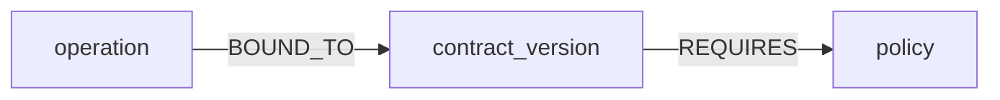

# EffectBound

A checkout times out after its effect committed. FalkorDB holds the contract-version edge. The counter scores the store. The screen shows that edge.

The graph `changeguard_checkout` holds these nodes: operation, observed_effect, dependency, contract_version, policy, approval, attempt, outcome.



The other relationships are operation `HAS_EFFECT` observed_effect, operation `DEPENDS_ON` dependency, attempt `AUTHORIZED_BY` approval, attempt `OF` operation, and attempt `YIELDED` outcome.

The decision is this read. It returns `reconcile`, `complete`, or `stop`.

```
MATCH (:operation {id: $operation_id})-[:BOUND_TO]->(:contract_version)-[req:REQUIRES]->(:policy)
RETURN req.policy_action
```

The screen prints that query and the `REQUIRES` action. Changing only `req.policy_action` changed the page from reconcile to stop. Stopping FalkorDB replaced the page with halt. The counter scores the store and does not read the graph. No model id is pinned.

The pinned image is `falkordb/falkordb@sha256:107455e862a824e45e8e9f5a7fbfdf5e00a08b14e13eae2577c72fd9e3f59ba6`. The container is `changeguard-falkordb`. The data directory is `/var/lib/falkordb/data`. The Python client is FalkorDB 1.8.0.

From this directory:

The compose project name is `changeguard`. A second copy uses that name so it attaches to the same container and the volume `changeguard_changeguard-falkor`.

```
docker compose -p changeguard up -d
```

```
docker inspect changeguard-falkordb --format "{{.Image}}"
```

If `.venv` is missing, create it and install this package with the venv Python. On Windows the interpreter is `.venv\Scripts\python.exe`.

```
python -m venv .venv
.venv\Scripts\python.exe -m pip install -e .
```

```
.venv\Scripts\python.exe -c "from effectbound.pins import IMAGE_DIGEST; print(IMAGE_DIGEST)"
```

```
.venv\Scripts\python.exe -m effectbound.serve
```

The screen URL is `http://127.0.0.1:8767/screen?operation_id=screen-op`.

`effectbound.serve` plants that one checkout.
